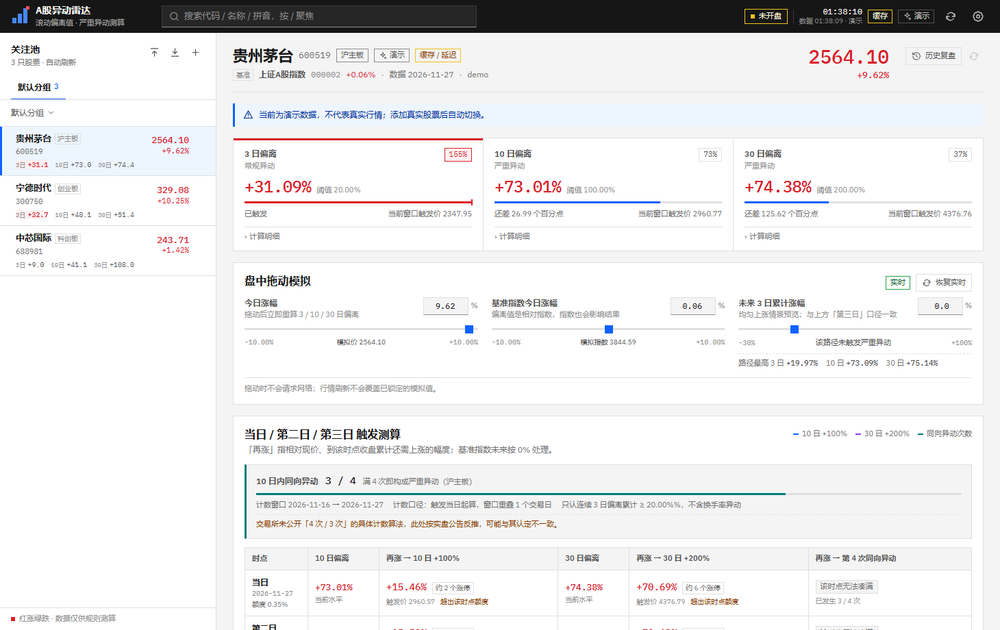

# A股异动雷达

一个面向 A 股短线复盘的桌面异动测算工具：关注池、3/10/30 日滚动偏离值、当日/第二日/第三日触发推演、盘中拖动模拟、历史真实 5 日复盘。



> 仅用于规则学习和风险识别，不构成投资建议。最终异动认定以交易所公告和上市公司披露为准。

界面采用 IBM Carbon 设计语言（浅色、方角、等宽数字），详见 [`docs/DESIGN.md`](docs/DESIGN.md)。

## 功能

- **关注池**：代码/名称/拼音搜索，分组、拖动排序、备注、CSV 导入导出。
- **滚动偏离值**：按区间复利涨幅差计算 3 日、10 日、30 日偏离值。
- **基准指数**：沪主板 000002 上证A股指数，深主板 399107 深证A股指数，创业板 399102 创业板综指，科创板默认 000680 科创综指（可切 000688 科创50）。
- **当日 / 第二日 / 第三日测算**：给出三个时点的 10 日、30 日偏离值，以及「再涨多少个百分点」会触发 10 日 +100%、30 日 +200% 与 10 日内 N 次同向异动，并标注触发价、约需几个涨停、该时点能否实现。
- **盘中模拟**：拖动今日涨幅、基准指数涨幅、未来 3 日累计涨幅，本地实时重算，不请求网络。
- **历史复盘**：最近 60 个交易日可选，回看当时偏离值，并展示之后真实 5 个交易日是否触发。
- **趋势图**：近 60 个交易日 3/10/30 日偏离曲线，点击日期进入复盘。
- **提醒**：关注池 80% 黄色、95% 红色；首次真实触发弹 Windows 通知；支持托盘常驻。
- **离线缓存**：行情源不可用时读取最近一次缓存，仍可继续拖动模拟。

## 快速开始

### 方式一：单文件便携版

双击 `A股异动雷达-1.2.0-win-x64.exe`。首次启动会解压运行文件到 `%LOCALAPPDATA%\AshareYidongRadar`，之后直接启动。

### 方式二：解压即用

解压 `A股异动雷达-1.2.0-win-x64-portable.zip`，双击 `AshareYidongRadar.exe`。不需要安装 Python、Node 或浏览器插件。

首次运行如遇 Windows SmartScreen“未知发布者”，选择“更多信息 → 仍要运行”即可。程序未做代码签名。

默认关闭窗口会最小化到系统托盘（保证提醒继续工作），从托盘菜单选择“退出”才会完全退出。

## 使用说明

1. 顶部搜索框输入代码、名称或拼音，点击结果加入当前分组。
2. 左侧点击股票，右侧查看 3/10/30 日偏离、阈值、进度和当前窗口触发价。
3. 拖动“今日涨幅”可模拟盘中收盘价；拖动“基准指数今日涨幅”可模拟指数；拖动“未来 3 日累计涨幅”可预览情景。
4. “当日 / 第二日 / 第三日 触发测算”表：
   - 每个时点给出该时点的 10 日、30 日偏离值（已计入窗口滚动：最早的交易日会滑出）。
   - “再涨”是相对现价、到该时点收盘累计还需上涨的百分比。
   - 同时给出触发价、约需几个涨停，以及是否落在该时点的涨跌幅额度内。
   - “再涨 → 第 N 次同向异动”是 10 个交易日内累积同向异动所需的最小涨幅。
5. 点击“历史复盘”选择日期，或点击趋势图上的某一天，查看真实后续 5 日。
6. 设置中可切换数据源、刷新间隔、基准口径、提醒、托盘和高级阈值。

## 计算口径

### 偏离值

对窗口内每个交易日，取个股日收益 `r_i` 和基准指数日收益 `q_i`：

```text
个股区间涨幅 = ∏(1 + r_i) - 1
指数区间涨幅 = ∏(1 + q_i) - 1
偏离值 = (个股区间涨幅 - 指数区间涨幅) × 100
```

即“先复利算区间涨幅，再相减”，不是把每天偏离值简单相加。

### 默认阈值

| 板块 | 3 日常规异动 | 10 日严重异动 | 30 日严重异动 | 同向异动次数 | 默认基准 |
|---|---|---|---|---|---|
| 沪主板 | ±20% | +100% / -50% | +200% / -70% | 10 日内 4 次 | 000002 上证A股指数 |
| 深主板 | ±20% | +100% / -50% | +200% / -70% | 10 日内 4 次 | 399107 深证A股指数 |
| 创业板 | ±30% | +100% / -50% | +200% / -70% | 10 日内 3 次 | 399102 创业板综指 |
| 科创板 | ±30% | +100% / -50% | +200% / -70% | 10 日内 3 次 | 000680 科创综指（可切 000688） |

补充：

- **2026-07-06 新《交易规则》**：沪深主板风险警示股票（ST / \*ST）涨跌幅限制由 ±5% 放宽至 ±10%，对应 3 日异常波动偏离值阈值由 ±12% 调整为 ±20%，与主板一致。本工具默认值已同步。
- 创业板/科创板 ST 涨跌幅限制仍为 20%，3 日阈值 30%。
- 新股上市前 5 日无涨跌幅限制，模拟范围会放宽并提示。
- 次数型判定（严重异常波动第（一）项）只认价格偏离值，**不含「3 日换手率 30 倍且累计 20%」的换手率异动**；交易所未公开具体计数算法，默认口径为按实盘公告反推，详见 `docs/SPEC-v1.1.md`。

## 数据来源

- 实时报价：腾讯行情 `qt.gtimg.cn`，东方财富 `push2.eastmoney.com` 备用。
- 日 K 线：东方财富 `push2his.eastmoney.com`，腾讯 `web.ifzq.gtimg.cn` 备用。
- 搜索：东方财富 suggest，腾讯 smartbox 备用。
- 个股使用前复权，指数使用不复权；数据在本地缓存，断网时显示缓存并标注。

公开行情接口可能延迟、限流或变更，工具不保证实时性；请以券商/交易所行情为准。

> 2026-11-27 已用真实行情做过端到端验证（三个样例股的主备源一致、偏离值与独立复算差 ≤0.04pp），
> 详见 [`docs/ACCEPTANCE.md`](docs/ACCEPTANCE.md)；联网验收用例可通过 `ASHARE_LIVE=1` 重跑。

## 本地开发

```bash
pnpm install
pnpm dev
pnpm test
pnpm typecheck
pnpm build
pnpm package:win
```

环境要求：Node.js 22+，pnpm 10+，Windows 10/11 x64。

## 目录

```text
src/main/        Electron 主进程：数据源、缓存、状态、通知、IPC
src/preload/     contextBridge 安全桥
src/renderer/    React 浅色界面
src/shared/      共享类型与纯计算引擎
tools/           无头浏览器视觉检查脚本
docs/            验收记录、需求确认单、视觉规范
```

## 已知限制

- 仅支持沪深主板、创业板、科创板；不支持北交所。
- 「10 日内 N 次同向异动」的计数算法未由交易所公开，默认口径为按实盘公告反推（触发当日起算、窗口重叠 1 个交易日），可在设置中切换；且只认价格偏离值、不含换手率异动，结论可能与交易所认定不一致。
- 次数型「再涨多少」的前推假设剩余交易日涨幅均匀分配。
- 历史前复权数据可能因后续除权除息修订，复盘值与当时盘中看到的值可能有细微差异。
- 提醒依赖应用运行/托盘常驻；完全退出后不会通知。
- 数据源为公开免费接口，不保证 SLA；商业使用请自行取得数据授权。
- 便携版未签名，Windows SmartScreen 可能提示未知发布者。

## License

MIT
